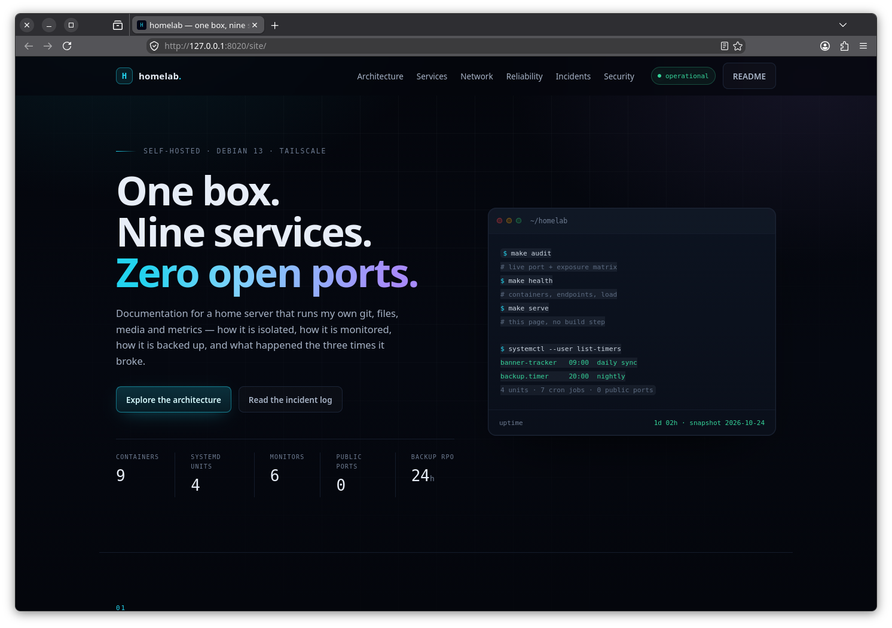
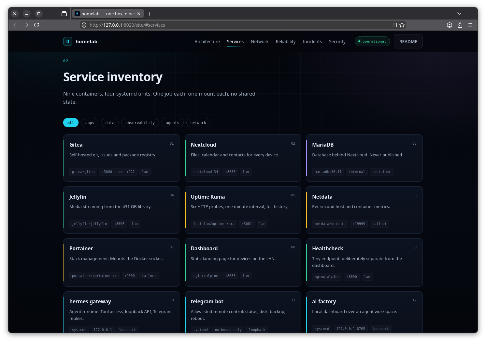
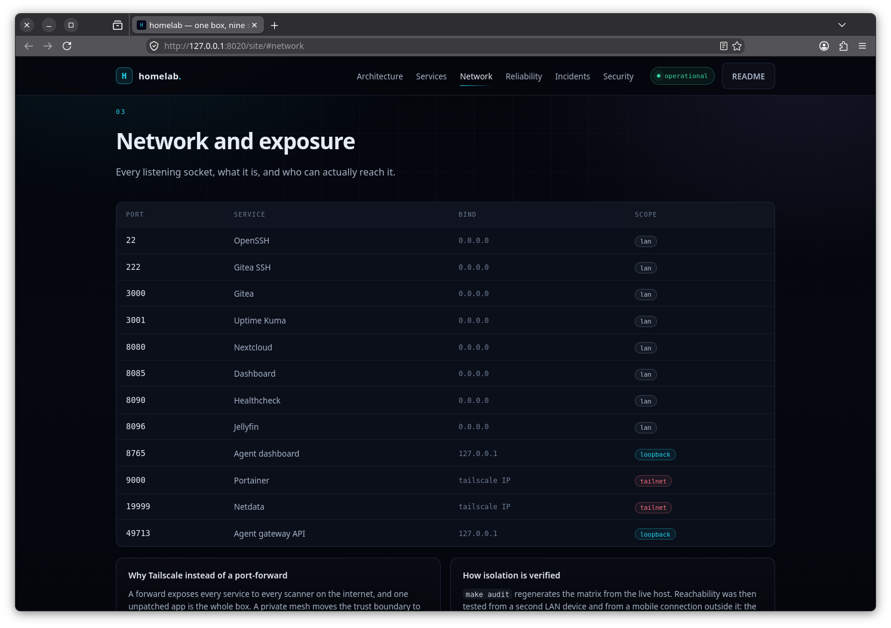
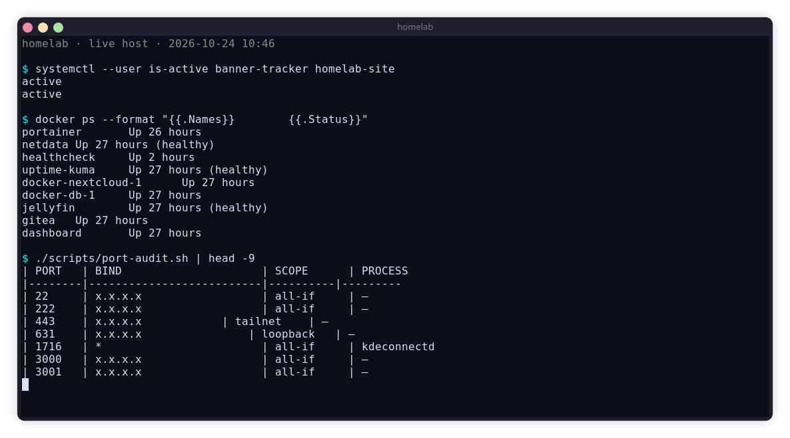
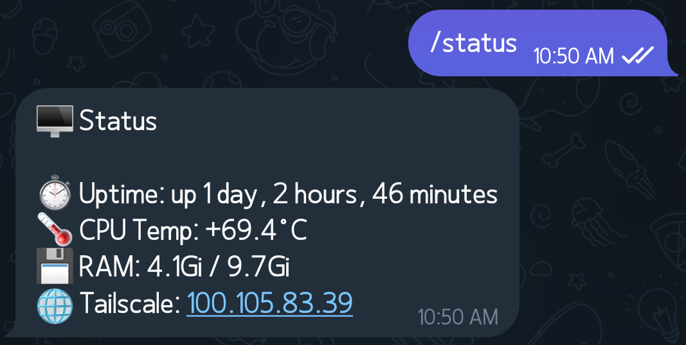

# homelab

**One Debian box. Nine containers, four services, zero ports open to the internet.**

This is the documentation repo for my self-hosted server: what runs on it, how it is
exposed (and not exposed), how it is monitored, and what happens when it breaks.
Configs here are sanitized copies of the live stack, not the live stack itself.

[](#service-inventory)
[](#service-inventory)
[](#access-model)
[](LICENSE)

> A browsable version of this document: <http://127.0.0.1:8020/site/> (`make serve`)


## At a glance

| | |
|---|---|
| **Host** | Debian 13 (trixie), kernel 6.12, 4 vCPU, 9.7 GiB RAM |
| **Storage** | 79 GB root SSD, two data disks (431 GB + 500 GB) for media, photos and backups |
| **Runtime** | Docker Engine + Compose, one project per service |
| **Remote access** | Tailscale (WireGuard). No port forwarding, no public DNS, no reverse proxy on the edge |
| **Alerting** | Telegram bot: container down/recovered, disk pressure, daily report, backup result |
| **Backups** | Nightly to a separate physical disk, plus a scripted restore path |
| **Uptime** | ~1 day at snapshot time, after a full OS migration (see [incidents](docs/incidents.md)) |

## Screenshots

The UI is a static page in [`site/`](site/) — no build step, no external requests.

| | |
|---|---|
|  |  |
| **Overview** — headline, live stats, ops quick reference | **Inventory** — nine containers, four systemd units, filterable |
|  |  |
| **Exposure** — every listening socket and who can reach it | **Live host** — units active, containers up, audit output |
|  | |
| **Remote control** — `/status` and `/df` answered by the allowlisted bot | |

Screenshots were taken from the running host and then sanitized: the tailnet address is
masked, and the page itself only ever renders placeholders.

## Service inventory

Nine containers, one job each. Everything that holds state keeps it on a mounted disk,
never inside the container.

| Service | Role | Image | Port | Exposure |
|---|---|---|---|---|
| Gitea | Self-hosted Git, issues, packages | `gitea/gitea` | 3000, 222 (SSH) | LAN |
| Nextcloud | Files, calendar, contacts | `nextcloud:34` | 8080 | LAN |
| MariaDB | Nextcloud database | `mariadb:10.11` | internal | container network |
| Jellyfin | Media streaming | `jellyfin/jellyfin` | 8096 | LAN |
| Uptime Kuma | HTTP monitors, status history | `louislam/uptime-kuma` | 3001 | LAN |
| Netdata | Per-second host + container metrics | `netdata/netdata` | 19999 | Tailnet only |
| Portainer | Container management UI | `portainer/portainer-ce` | 9000 | Tailnet only |
| Dashboard | Static landing page for the LAN | `nginx:alpine` | 8085 | LAN |
| Healthcheck | Static "is nginx alive" page | `nginx:alpine` | 8090 | LAN |

Alongside Docker, four systemd units run things that do not belong in a container:

| Unit | What it does |
|---|---|
| `hermes-gateway` | Agent runtime; loopback-only API, replies over Telegram |
| `ai-factory-dashboard` | Local web UI for an agent workspace, bound to `127.0.0.1:8765` |
| `telegram-bot` | Remote control: `/status`, `/docker`, `/df`, `/temp`, `/backup`, `/reboot`, `/shutdown` |
| `tailscaled` | WireGuard mesh that makes remote access possible without opening ports |

## Access model

Three tiers. The tier decides both the bind address and who can reach it.

| Tier | Bind | Reachable from | Used by |
|---|---|---|---|
| **Tailnet** | Tailscale IP | Devices signed into my tailnet, authenticated by WireGuard keys | Netdata, Portainer, SSH |
| **LAN** | `0.0.0.0` | Devices on the same physical network only — verified unreachable from outside | Gitea, Nextcloud, Jellyfin, Kuma, dashboards |
| **Loopback** | `127.0.0.1` | The host itself | Agent gateway API, agent dashboard |

The important part is what is *absent*: no router port-forward, no public DNS record, no
Cloudflare tunnel, no `0.0.0.0` on an internet-facing interface. Remote access happens
over Tailscale, so a service can be fully private and still usable from a phone.

Verification method and results: [docs/network.md](docs/network.md).

## Reliability

### Monitoring

Uptime Kuma probes six HTTP endpoints every minute and keeps the history. On top of that,
a cron job checks the container list every five minutes and messages me on Telegram when
something goes down — and once more when it comes back, so I do not have to watch a
dashboard to notice a recovery.

### Backups

Nightly at 20:00 to a *different physical disk* from the one holding the data:

- Docker project folders (compose files, nginx roots, configs)
- The automation scripts and the systemd units
- `crontab`
- A `mysqldump` of the Nextcloud database, gzipped
- A generated manifest: hostname, OS, Docker/Compose versions, file sizes

The script traps errors and sends the failing step to Telegram, so a silent half-backup is
not possible. Restoration is a separate script with a confirmation prompt that puts the
files back and tells you the three manual steps left. Drill notes and timings:
[docs/runbook-backup.md](docs/runbook-backup.md).

### Automation

| When | Job |
|---|---|
| every 5 min | container health, CPU/RAM, Tailscale reachability |
| hourly | disk usage warning |
| 7× a day | daily report (uptime, CPU temp, RAM, disks, container list) |
| 20:00 | full backup |
| 20:10 | extra backup (photos, configs) |
| 09:00 | banner-tracker data sync (separate project, systemd timer) |

## Security posture

- **Remote access is a private network, not a public endpoint.** Tailscale authenticates
  devices with WireGuard keys; nothing listens on the WAN.
- **The Telegram bot is allowlisted.** Every handler is wrapped in a decorator that
  compares `effective_user.id` against one stored ID and replies `Unauthorized` otherwise.
  Commands run through a `restricted` wrapper, so a stranger messaging the bot gets nothing.
- **Secrets are out of the repo.** Tokens and passwords live in `.env` files outside git;
  this repo ships `.env.example` only. The sanitization pass for this repo caught a
  hardcoded bot token in three scripts — see [docs/security.md](docs/security.md).
- **Least data on the edge.** No service holds the whole disk: containers get one mount
  each, and only Portainer sees the Docker socket (read-write, because it must manage stacks).

Known gaps are listed honestly in [docs/security.md](docs/security.md#known-gaps) —
including the weak default database password that is still on the list to rotate.

## Incidents

The interesting part of running a server is the failures. Three are written up in
[docs/incidents.md](docs/incidents.md):

1. **A seven-day outage that the uptime graph did not show** — migrating the host from
   Arch to Debian, and why a monitor that lives on the monitored box cannot tell you the
   box is gone.
2. **The 75.7% uptime that was not real** — how sparse heartbeat history made a healthy
   month look like a broken one, and the query that proved it.
3. **A Compose project named `docker`** — generic project names collide with the tooling
   and produce container names nobody can reason about.

## Repo layout

```
.
├── compose/           sanitized stacks, one directory per service family
├── systemd/           unit files for the non-container services
├── scripts/           backup, restore, healthcheck, port audit, bootstrap
├── site/              static portfolio UI (no build step, no CDN)
├── docs/              architecture, network, runbooks, incidents, security
└── Makefile           serve the UI, run the audit, back up
```

## Run it

The UI is plain HTML/CSS/JS — no build step, no external requests:

```bash
make serve          # http://127.0.0.1:8020/site/
make audit          # print the live port/exposure matrix
make health         # containers, endpoints, load
make backup         # run the backup script (needs .env)
```

On the live host the UI is a systemd user unit (`systemd/homelab-site.service`), so it
stays up at <http://127.0.0.1:8020/site/> without a terminal.

To rebuild a similar box from scratch:

```bash
sudo ./scripts/bootstrap.sh     # docker, compose plugin, directories, sysctl
cp compose/.env.example compose/.env && $EDITOR compose/.env
make up                         # docker compose up -d for every stack
```

## Roadmap

- [ ] Rotate the Nextcloud database password and move it to `.env`
- [ ] Move bot token to `EnvironmentFile=` for every unit that needs it
- [ ] Add an external dead-man's-switch (healthchecks.io or a second host) so a dead
      server pages me instead of going quiet
- [ ] Pin image digests instead of `:latest` for reproducible updates
- [ ] Bind LAN-tier services to the Tailscale interface and drop the LAN tier entirely

## License

MIT — see [LICENSE](LICENSE). Configs are sanitized; secrets, hostnames and IDs are
placeholders.
