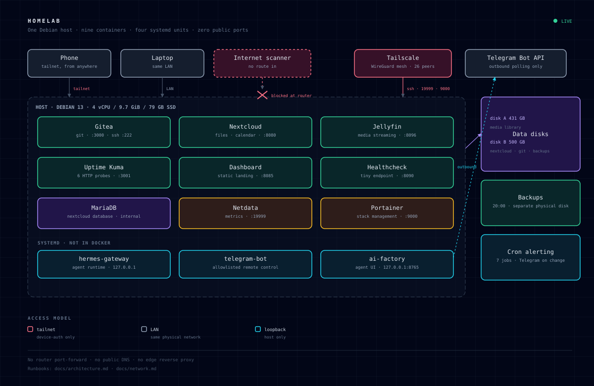

# Architecture

## The shape of it

One physical machine, three planes:

1. **Data plane** — Docker containers serving files, media, git and metrics, each with its
   own volume on a data disk.
2. **Control plane** — systemd units that are not request/response services: the agent
   runtime, its dashboard, and the Telegram bot that lets me operate the box from a phone.
3. **Access plane** — Tailscale for remote access, the LAN for local devices, loopback for
   anything that should never leave the host.

Nothing is published to the internet. The router has no port-forward and there is no
public DNS record, so the only way in from outside is a WireGuard peer.

## Diagram

## Containers

Every stack is its own Compose project in its own directory, started independently. That
means one broken stack does not block the others, and `docker compose pull` can be run
per service.

| Stack | Depends on | State lives in |
|---|---|---|
| `gitea` | — | `/data` on data disk 2 (repos, attachments, SQLite) |
| `nextcloud` | `db` | app dir on the root disk, database on data disk 2, media mounted read-write |
| `jellyfin` | — | named volumes for config/cache, media mounted read-only-ish from data disk 2 |
| `uptime-kuma` | — | SQLite on data disk 2 |
| `netdata` | host `/proc`, `/sys`, Docker socket (ro) | named volumes |
| `portainer` | Docker socket (rw) | named volume |
| `dashboard` | — | static HTML bind mount, read-only |
| `healthcheck` | — | static HTML bind mount, read-only |

Two nginx containers look redundant but are not: `dashboard` is the human landing page for
the LAN, `healthcheck` is a deliberately tiny endpoint used by the external check and by
the monitoring scripts. Keeping them separate means a broken dashboard cannot take the
health endpoint down with it.

## Non-container services

| Unit | Bind | Why not Docker |
|---|---|---|
| `hermes-gateway` | `127.0.0.1` | Needs the host's toolchain, filesystem and user session to do useful work |
| `ai-factory-dashboard` | `127.0.0.1:8765` | Same; a web UI over a workspace on the host |
| `telegram-bot` | outbound only | Talks to the Telegram API over long polling; no inbound socket at all |
| `tailscaled` | `:41641/udp` + tailnet | Must own the network namespace to route traffic |

## Resource budget

The box is a small desktop, not a rack server, so the budget is real:

| Resource | Total | Typical use |
|---|---|---|
| CPU | 4 vCPU | ~10–15% idle-ish, spikes during Jellyfin transcode |
| RAM | 9.7 GiB | ~4 GiB in use; Netdata and Nextcloud are the heavy pair |
| Root SSD | 79 GB | 50% used |
| Data disk 1 | 431 GB | 68% used (media) |
| Data disk 2 | 500 GB | 75% used (media, backups, Nextcloud data) |

Design consequence: media lives on spinning disks and is mounted into containers, while
application state stays on the SSD where it is fast and easy to back up.

## Data flow examples

**A photo upload:** phone → Nextcloud (LAN) → PHP writes to mounted disk → MariaDB records
metadata → nightly `mysqldump` + file backup to the other physical disk.

**A push:** laptop → Gitea over SSH on port 222 → bare repos on disk 2 → Gitea's own
SQLite for issues/PRs.

**An alert:** cron → `docker_monitor.sh` → Telegram Bot API → phone. No inbound connection
to the server is involved, which is why the bot works even when the LAN is unreachable.

**A recovery:** phone → Tailscale → SSH → `scripts/restore.sh` → files back in place →
`docker compose up -d` per stack.
